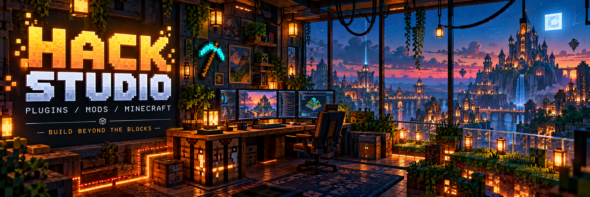

<div align="center">



<br />
<br />

<sub>GAMING ROOTS &nbsp; / &nbsp; DEVELOPER MINDSET &nbsp; / &nbsp; MINECRAFT AT THE CORE</sub>

# Build beyond the blocks.

**Welcome to HACK STUDIO.**

A studio where Minecraft ideas become code.<br />
Developing and publishing plugins, mods, and projects for the game we love.

<br />

[](https://github.com/hiteshmalhotra2026?tab=repositories)
[](https://github.com/hiteshmalhotra2026?tab=repositories)
[](https://github.com/hiteshmalhotra2026)

<br />

[The studio](#-inside-the-studio) &nbsp; · &nbsp; [What we build](#-the-crafting-table) &nbsp; · &nbsp; [Projects](#-the-project-vault) &nbsp; · &nbsp; [Player corner](#-player-corner)

<br />

`IDEA` &nbsp; → &nbsp; `CODE` &nbsp; → &nbsp; `CRAFT` &nbsp; → &nbsp; `PLAY`

</div>

<br />

## ⛏ Inside the studio

<table>
<tr>
<td width="62%" valign="top">

### Made for the world beyond vanilla.

**HACK STUDIO** brings together gaming and development, with Minecraft at the center.

We code, develop plugins and mods, and publish our work. This is the home for those projects and the ideas behind them.

From the first experiment to a published build, it starts with a simple question: **what could we add to this world?**

</td>
<td width="38%" valign="top">

<sub>STUDIO FILE / 001</sub>

**Identity**<br />
HACK STUDIO

**World**<br />
Minecraft

**Craft**<br />
Plugins · Mods · Code

**Home base**<br />
[Studio repositories ↗](https://github.com/hiteshmalhotra2026?tab=repositories)

</td>
</tr>
</table>

<br />

## ▦ The crafting table

| Department | What happens here |
| :--- | :--- |
| **⌘ Plugin development** | Building plugins for Minecraft. |
| **◈ Mod development** | Creating mods that add to the Minecraft experience. |
| **↗ Publishing** | Sharing the studio's work through its projects. |
| **🎮 Gaming** | Playing the game that inspires the work. |

<br />

<div align="center">

**CODE IS THE TOOL. MINECRAFT IS THE CANVAS.**

</div>

<br />

## ▣ The project vault

The studio's repositories are the place to explore its published code and projects.

### [Browse HACK STUDIO projects ↗](https://github.com/hiteshmalhotra2026?tab=repositories)

<!-- Optional: add verified project links here as you choose what to feature.
| Project | Description | Link |
| :--- | :--- | :--- |
| Project name | What it does | Repository URL |
-->

<br />

<details>
<summary><b>▸ Before loading a project</b></summary>

<br />

Check that project's README for setup instructions, supported versions, and usage details.

For an issue or suggestion, use the project's issue tracker when available. Include the version you used and enough detail to reproduce the problem.

</details>

<br />

## 🎮 Player corner

```text
WORLD          Minecraft
LOADOUT        Code + creativity
SIDE QUEST     One more build
SPAWN POINT    HACK STUDIO
```

Some sessions are for development. Some are for playing. Both lead back to Minecraft.

<br />

## ↗ Find the studio

[](https://github.com/hiteshmalhotra2026)

<br />

---

<div align="center">

<br />

### Every world has room for another idea.

<sub>HACK STUDIO &nbsp; / &nbsp; PLUGINS · MODS · MINECRAFT</sub>

<br />
<br />

`SAVE THE BUILD. LOAD THE WORLD.`

<br />

</div>
